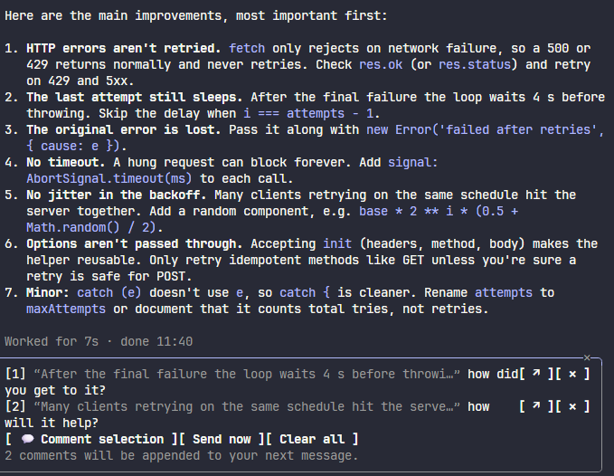
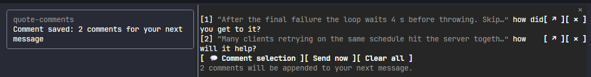
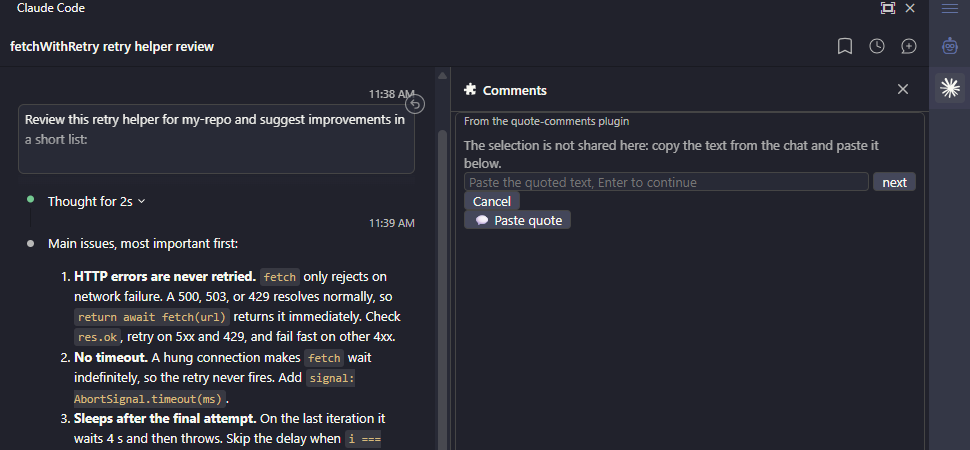
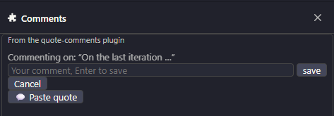
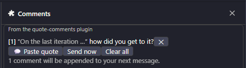
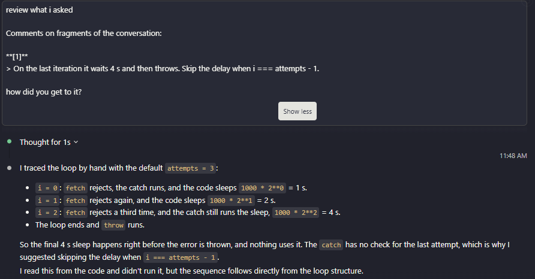

# quote-comments

Comment on fragments of the conversation, the way Claude Desktop lets you reply to a selection. Select text in the chat,
run `/comment`, type a remark: the quote and the remark go into a **Comments** pane. Collect as many as you like; on
your next message they are appended after your own text, each as a quote with your comment under it, and the pane is
cleared.



The pane on its own:



## Usage

### With a selection (terminal fullscreen, Claude Desktop)

1. Select text in the chat with the mouse.
2. Run `/comment` (or press **+ Add Comment** in the pane). The pane opens with the start of the quote and a
   field for your comment; Enter saves it.
   `/comment <text>` saves the selection with that comment in one go, without stopping at the field.
3. Repeat for other fragments. Each saved comment becomes a row in the pane.
4. Type your message in the prompt as usual and send it. The comments are appended to it (see
   [the message format](#what-claude-receives)), then the list is cleared and the pane closes.

### With a pasted quote (VS Code, terminal main screen)

Where the chat selection is not shared with mods, the pane asks for the quote instead:

1. Copy the fragment from the chat (Ctrl+C).
2. Run `/comment` (or press **+ Paste Quote** in the pane). The pane shows a 3-row field "Paste the quoted text, Enter
   to continue": paste and press Enter.
3. The comment field appears; type the comment and press Enter.

`/comment <text>` works here too: the comment is remembered, and the pasted quote is saved with it right after Enter.
A pasted quote has no **↗**, since it is not tied to a transcript row.



After the quote is pasted, the pane asks for the comment; once saved, it shows up as a row:





## What Claude receives

Your own text comes first, then one block with all the comments, numbered in pane order:

````
Please update the plan with these points.

Comments on fragments of the conversation:

**[1]**
> retry up to 3 times with exponential backoff

Why 3? The upstream API already retries once.

**[2]**
> run the migration during the maintenance window

We have no maintenance window, it has to be online.
````

- Each quote is a Markdown blockquote; multi-line quotes keep their lines. Quotes longer than 2000 characters are cut
  with an ellipsis.
- If the prompt is empty (for example with **Append all to Chat** and nothing typed), the message is the block alone.
- Slash commands and system messages are passed through untouched: the comments wait for your next real message.



## Pane reference

| Element | What it does |
| --- | --- |
| `[n] “quote” comment` | One saved comment card: its number in the message, the start of the quote, and the comment note |
| **↗ Jump** | Scrolls the transcript to the quoted message (only for quotes taken from a selection) |
| **Edit** | Opens an input field to modify and update the comment note |
| **Delete** | Removes that comment |
| **+ Add Comment** / **+ Paste Quote** | Same as `/comment`; the label depends on the surface. Hotkey `c` while the pane has focus |
| **Save** / **Cancel** | Confirms or discards the active draft or comment note edit |
| **Append all to Chat** | Submits whatever is in the prompt box together with the comments |
| **Clear all** | Drops all collected comments without sending them |
| `N comments will be appended to your next message.` | Reminder line shown while the list is not empty |

## Where it works

| Surface | Selection | How you add a quote |
| --- | --- | --- |
| Terminal, fullscreen mode | Read by the mod | Select with the mouse, then `/comment` or **+ Add Comment** |
| Terminal, main screen | Belongs to the terminal emulator, not shared | Copy, `/comment` or **+ Paste Quote**, paste into the pane |
| Claude Desktop | Supported by the engine | Select, then `/comment` or **+ Add Comment** |
| VS Code extension | Not shared by the client | Copy, `/comment` or **+ Paste Quote**, paste into the pane |
| Mobile | — | The pane renders no input field and shows a hint instead |
| Antigravity (Auxiliary Pane) | The chat selection is not visible to the pane | **+ Paste Quote**, paste; **Append all to Chat** sends them (there is no prompt hook, so nothing is appended automatically) |

If no surface can place the pane at all, `/comment` answers with a short text explaining that instead of failing
silently.

## Limitations

- **VS Code shares no selection.** The extension does not pass the chat selection to mods, so the quote has to be
  copied and pasted.
- **No clipboard read.** Mods cannot read the clipboard, so the pasted-quote flow needs an explicit paste into the pane.
- **No global hotkey.** The `c` hotkey works only while the pane holds focus (move focus to it with `ctrl+x tab`); from
  the prompt, use `/comment`.
- Comments are kept in session state: they survive a reload of the mod, but not a new session.

## Install

```
/plugin marketplace add gidragir/claude-mods
/plugin install quote-comments@claude-mods
```

## Develop

```bash
pnpm check quote-comments
```

Built with [Bifrost](../../packages/bifrost/README.md): the appended block is formatted in `src/comments.ts`
(pure, unit-tested), state and actions are in `src/store.ts`, the pane in `src/ui.tsx`, and `src/plugin.tsx` wires
the command and the prompt hook. `pnpm dev quote-comments` rebuilds on save; `bun test` in this folder runs the
fast tests.
