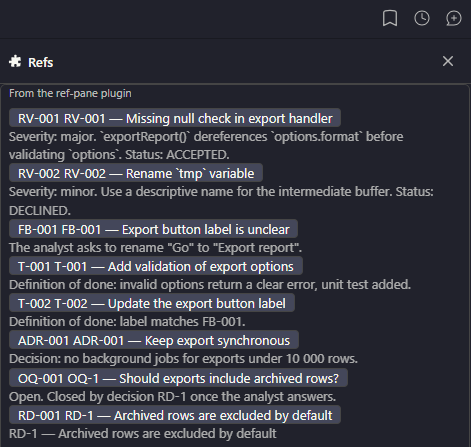

# ref-pane

An artifact reference browser for **Claude Code** and **Antigravity**, built once with [Bifrost](../../packages/bifrost/README.md): resolves references like `RV-1`, `FB-2`, `T-3`, `ADR-4` from conversation turns and project docs, displaying the matching artifact section (`features/<TICKET>/…` or `docs/*.md`) with syntax styling.

## Interfaces

| Claude Code (Terminal TUI) | Antigravity (Auxiliary Pane Web UI) |
| :---: | :---: |
|  |  |

---

## Dual-Target Support

### 1. Claude Code (TUI Mod)

- References from the model's reply appear in the interactive Refs pane automatically (background scanning without blocking turns).
- `/ref RV-1` displays the section for a specific reference; `/ref` without arguments opens or focuses the pane.
- Scans `features` directories (`cwd/features/<TICKET>/...`) and flat documents (`docs/*.md`).
- Table rows and headings count as definitions (`| D-26 | … |`), while list items count as mentions.

### 2. Antigravity (Auxiliary Pane)

- The same pane in the Auxiliary Pane webview: open it with `[Refs Pane](sidecar://ref-pane/)` or from the pane tab.
- On open it lists the references defined near the workspace folder; the search box filters them, and Enter resolves the IDs it names.
- Markdown sections are rendered to sanitized HTML on the server; colors follow the IDE theme.
- "Add to chat (a)" quotes the text selected in the pane (or the whole section) into the chat prompt.
- Ships `skills/ref-pane/` (reference-aware navigation) and `rules/AGENTS.md` (artifact citation standards).

---

## Install

### Claude Code

```
/plugin marketplace add gidragir/claude-mods
/plugin install ref-pane@claude-mods
```

### Antigravity

```
agy plugin install gidragir/claude-mods#release/ref-pane
```

In Antigravity the prefixes come from the environment variable `REF_PANE_PREFIXES` (same format as below).

---

## Configuring Prefixes

A custom set of prefixes is defined by the plugin option `prefixes`: `/config` → ref-pane → "Artifact prefixes" (or when installing the plugin). The format is `PREFIX=dir`, comma-separated:

```
RV=review, FB=feedback, BUG=bugs, ADR
```

- **Prefix**: 1–4 uppercase Latin letters. Longer identifiers (e.g., `TICKET-123`) are treated as ticket numbers.
- **Dir**: a subfolder of `features/<TICKET>/` where the section is looked up first. Without `=`, the directory defaults to the lowercase prefix (`ADR` = `ADR=adr`).
- A custom list **replaces** the default set rather than extending it. An empty value restores defaults (`RV`, `FB`, `T`, `TASK`, `ADR`, `DBG`, `OQ`, `BQ`, `RD`, `D`, `Q`, `FR`, `NFR`, `AC`, `US`).
- Numbers may contain letters (e.g. `Q-L1`, `Q-P21`). Non-artifact tokens like `UTF-8` or `SHA-256` are ignored.

---

## Development & Testing

```bash
pnpm dev ref-pane      # build plugins/ref-pane/dist and rebuild on save
bun test               # from this folder: reference parsing and the pane, ~50 ms
pnpm check ref-pane    # build + claude plugin validate + tsc + engine tests
```

`src/refs.ts` finds and extracts references (pure, files through `FsLike`); `src/store.ts` holds the state
and actions; `src/ui.tsx` is the pane; `src/plugin.tsx` wires commands, Claude events and config.
