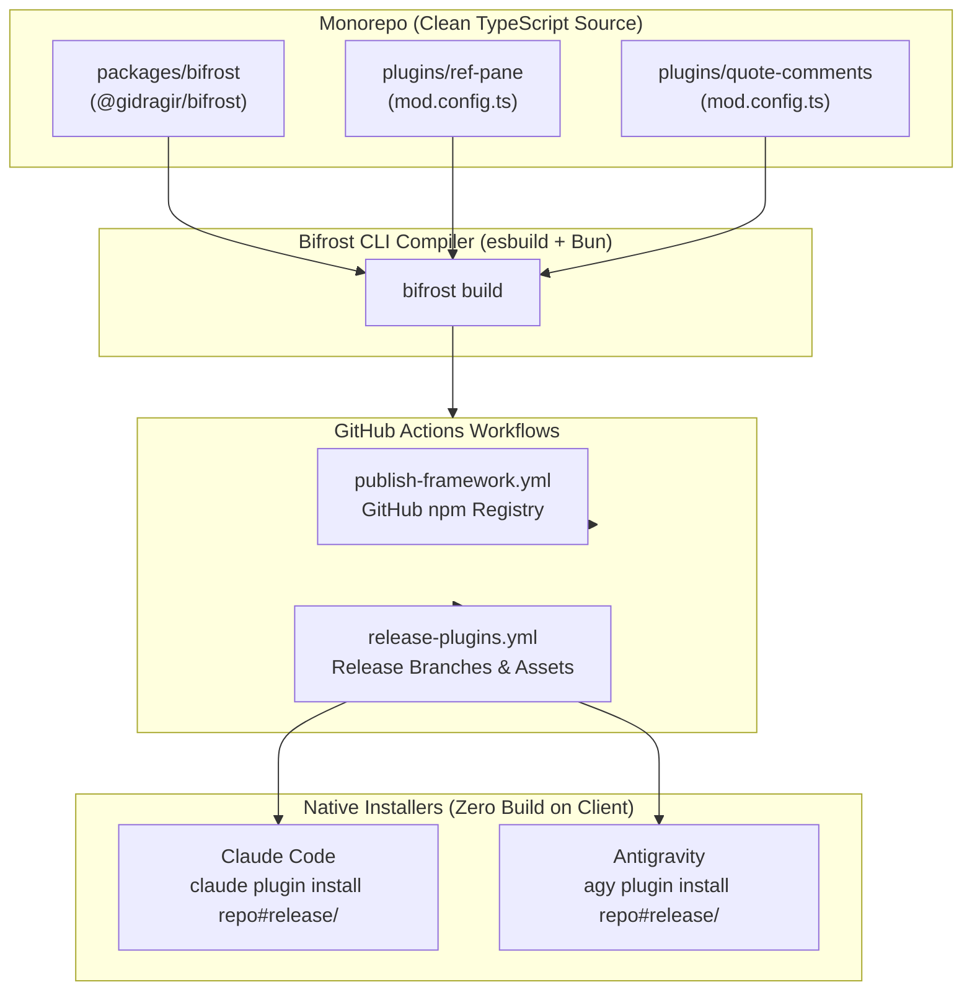

# Implementation Plan: Bifrost Cross-Harness Framework & Monorepo Migration

## 1. Goal Description

Build and deploy **Bifrost** (`@gidragir/bifrost`) — a high-performance, type-safe, zero-friction cross-harness framework for developing plugins and mods for both **Google Antigravity** (IDE webviews, sidecars, skills, rules, CLI hooks) and **Claude Code** (sandboxed TUI panes, in-process hooks, atom state).

The project also involves:
1. Migrating development tooling and tests in the monorepo to **Bun**.
2. Upgrading existing plugins ([`plugins/ref-pane`](../plugins/ref-pane) and [`plugins/quote-comments`](../plugins/quote-comments)) and the scaffold template to use Bifrost.
3. Setting up **GitHub Actions CI/CD** to publish `@gidragir/bifrost` to GitHub Packages and automatically publish release branches (`release/<plugin>`) and tarball assets for native one-command installation via `claude plugin install` and `agy plugin install`.



---

## 2. Key Architecture Decisions

### 2.1. Unified Package with Subpath Exports (`@gidragir/bifrost`)
Instead of managing separate packages, the framework is a single npm package with clean subpaths:
- `import { defineClaudePlugin, createSidecarApp, FsLike } from '@gidragir/bifrost/server'`
- `import { renderMasterDetail, Card, createWebviewClient } from '@gidragir/bifrost/ui'`
- `import { defineMod } from '@gidragir/bifrost'`

Published to **GitHub npm Registry** (`https://npm.pkg.github.com`) under the `@gidragir` scope.

### 2.2. Dual-Environment Runtime Model
- **Claude Code**: Runs inside a strict worker sandbox (no `node:*` modules, no DOM, strict ~5000ms heartbeat watchdog). Handled via `defineClaudePlugin()` with automatic atom state management, IPC error boundaries, and Flexbox TUI components.
- **Antigravity**: Runs a background Node 20+ sidecar HTTP daemon + Electron Webview. Handled via `createSidecarApp()` with automatic `ANTIGRAVITY_SIDECAR_UI_TOKEN` verification, Windows junction resolution (`realpathSync.native`), `/preload.js` injection with fallback `window.sidecar`, and semantic Pico CSS syncing with `--background`/`--foreground` custom properties.

### 2.3. Zero-Build Native Distribution via Release Branches
- The `main` branch remains 100% clean TypeScript source code (`dist/` is in `.gitignore`).
- CI/CD automatically compiles plugins via `esbuild` and pushes the standalone bundles to dedicated orphan branches: `release/<plugin-name>` (e.g. `release/ref-pane`).
- Both native installers (`claude plugin install owner/repo#release/<mod>` and `agy plugin install owner/repo#release/<mod>`) work out of the box because git clones the pre-compiled, zero-dependency bundle.
- Tarball release assets are also attached to GitHub Releases for marketplace catalogs.

---

## 3. Proposed Changes & Implementation Steps

### Phase 1: Package `@gidragir/bifrost` (`packages/bifrost/`)

#### 1.1. Package Manifest (`packages/bifrost/package.json`)
```json
{
  "name": "@gidragir/bifrost",
  "version": "0.1.0",
  "description": "Cross-harness plugin framework for Claude Code and Google Antigravity",
  "type": "module",
  "main": "./dist/index.js",
  "types": "./dist/index.d.ts",
  "bin": {
    "bifrost": "./dist/cli.js"
  },
  "exports": {
    ".": {
      "import": "./dist/index.js",
      "types": "./dist/index.d.ts"
    },
    "./server": {
      "import": "./dist/server.js",
      "types": "./dist/server.d.ts"
    },
    "./ui": {
      "import": "./dist/ui.js",
      "types": "./dist/ui.d.ts"
    },
    "./core": {
      "import": "./dist/core.js",
      "types": "./dist/core.d.ts"
    }
  },
  "publishConfig": {
    "registry": "https://npm.pkg.github.com",
    "access": "public"
  },
  "dependencies": {
    "esbuild": "^0.25.0"
  }
}
```

#### 1.2. Core Layer (`packages/bifrost/src/core/`)
- `FsLike` interface (`list`, `read`, `write`, `stat`) with safe single-pass directory traversal helpers.
- `HeadlessStore<TState, TAction>`: reactive state container with command/action dispatchers independent of DOM or TUI.
- `defineMod(config: ModConfig)`: schema definition and type-safe configuration object.

#### 1.3. Server Layer (`packages/bifrost/src/server/`)
- **Claude Code Adapter (`defineClaudePlugin`)**:
  - Automatically manages `$.state` atoms, registers slash commands, and maps `$.fs` to `FsLike`.
  - Built-in error guards with `.catch()` wrapping to avoid worker termination from unhandled host rejections.
  - Heartbeat / watchdog safety to stay within ~5000ms sandbox limits.
- **Antigravity Adapter (`createSidecarApp`)**:
  - Zero-dependency HTTP/SSE daemon using `node:http`.
  - Automatic `ANTIGRAVITY_SIDECAR_UI_TOKEN` validation (HTTP 401).
  - Windows junction and case-insensitive main module detection (`realpathSync.native`).
  - Automatic `/preload.js` injection with fallback `window.sidecar` polyfill.
  - Lifecycle hook bridge for executing commands via `hooks.json`.

#### 1.4. UI Layer (`packages/bifrost/src/ui/`)
- **TUI Patterns (`/tui`)**:
  - `renderMasterDetail<T>()`, `Card()`, `renderEmptyState()`, `truncate()`, responsive text wrap.
- **Webview Helpers (`/web`)**:
  - Semantic Pico CSS theme engine syncing `--background`, `--foreground`, and `--accent-color` on `theme-change`.
  - `createWebviewClient()` wrapping `window.sidecar.fetch()` with security token headers.
  - Chat context and selection quoting (`quoteToChat` with dual `add-chat-context` / `insert-prompt`).
  - Zero-dependency server-side Markdown parser and sanitizer (`renderMarkdown`).

#### 1.5. CLI Compiler (`packages/bifrost/src/cli/`)
- `bifrost build` command on esbuild:
  - **Claude Target**: Compiles entry to `dist/claude.js` (ESM, transforms JSX to `h(...)`, marks `claude-code` external, inlines core & TUI).
  - **Sidecar Target**: Compiles server to `dist/sidecar.mjs` (ESM for Node 20+, marks `node:*` external, inlines markdown parser & router).
  - **Webview Target**: Bundles `ui/index.html` with Pico CSS and client JS inlined directly.
  - **Manifest Generator**: Reads `mod.config.ts` and outputs:
    - `.claude-plugin/plugin.json` & `hooks/hooks.json`
    - `plugin.json` (Antigravity root)
    - `hooks.json` (Antigravity lifecycle root)
    - `sidecars/<name>/sidecar.json`

---

### Phase 2: Monorepo Tooling & Bun Migration

1. Update root `package.json` to leverage `bun`:
   - `"test": "bun test"`
   - `"build": "bun run --filter '*' build"`
2. Add `bunfig.toml` configuring workspaces and test timeouts.
3. Replace `packages/ui` imports across the codebase with `@gidragir/bifrost`.

---

### Phase 3: Plugin Migration

#### 3.1. `plugins/ref-pane`
- Add `mod.config.ts`:
  ```typescript
  import { defineMod } from '@gidragir/bifrost'

  export default defineMod({
    name: 'ref-pane',
    displayName: 'Refs Pane',
    version: '0.3.0',
    description: 'A pane of references like RV-1/FB-2/T-3 from the model reply: shows ticket artifact sections',
    sidecar: {
      enabled: true,
      title: 'Refs',
      entrypoint: 'SIDECAR_UI_ENTRYPOINT_AUX_PANE'
    },
    commands: [
      { name: 'refs', description: 'Inspect referenced artifacts' }
    ],
    configSchema: {
      prefixes: { type: 'string', default: 'RV,FB,T,TASK,ADR,DBG,OQ,BQ,RD,D,Q,FR,NFR,AC,US' }
    }
  })
  ```
- Refactor `hooks/register.tsx` to `defineClaudePlugin`.
- Refactor `sidecars/ref-pane/server.mjs` to `createSidecarApp`.

#### 3.2. `plugins/quote-comments`
- Apply the same Bifrost architecture refactoring.

#### 3.3. `templates/mod`
- Update scaffolding template to use Bifrost and `mod.config.ts`.

---

### Phase 4: GitHub Actions CI/CD Pipeline

#### 4.1. `.github/workflows/publish-framework.yml`
- Trigger: Tag push matching `framework-v*`.
- Steps:
  1. `bun install && bun test`
  2. `bun run build`
  3. `bun publish --registry https://npm.pkg.github.com` (using `secrets.GITHUB_TOKEN`).

#### 4.2. `.github/workflows/release-plugins.yml`
- Trigger: Tag push matching `<plugin>-v*` or manual dispatch.
- Steps:
  1. Matrix build for changed plugins using `bun x bifrost build`.
  2. Package tarball `plugin.tar.gz` and attach to GitHub Release.
  3. Push pre-compiled plugin folder to orphan branch `release/<plugin-name>`.

---

## 4. Verification & Testing Strategy

1. **Automated Tests**:
   - `bun test packages/bifrost` — verifies `FsLike`, `HeadlessStore`, `createSidecarApp` routing/tokens, and markdown parsing.
   - `bun test plugins/ref-pane` and `plugins/quote-comments` — verifies 100% green test status on plugins.
2. **Build Verification**:
   - Run `bun x bifrost build` on each plugin and verify `dist/claude.js` (< 50 KB), `dist/sidecar.mjs` (< 50 KB), and `dist/index.html` are generated with valid manifests.
3. **Live Verification**:
   - Antigravity: `bun run dev:link:gemini ref-pane` -> verify Auxiliary Pane loads and reflects theme changes.
   - Claude Code: `bun run dev:link ref-pane` -> run `/refs` in terminal, verify TUI Master-Detail navigation.
