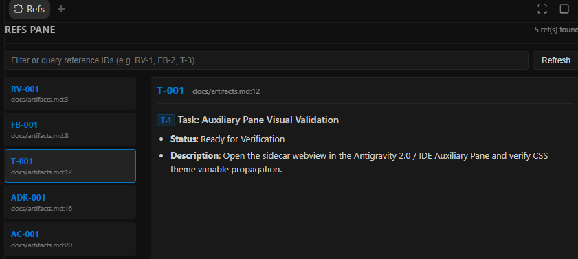

# ref-pane

A dual-target artifact reference browser for **Claude Code** and **Antigravity**: resolves references like `RV-1`, `FB-2`, `T-3`, `ADR-4` from conversation turns and project docs, displaying the matching artifact section (`features/<TICKET>/…` or `docs/*.md`) with syntax styling.

## Interfaces

| Claude Code (Terminal TUI) | Antigravity (Auxiliary Pane Web UI) |
| :---: | :---: |
|  |  |

---

## Dual-Target Support

### 1. Claude Code (TUI Mod)

- References from the model's reply appear in the interactive Refs pane automatically (background scanning without blocking turns).
- `/ref RV-1` displays the section for a specific reference; `/ref` without arguments opens or focuses the pane.
- Scans `features` directories (`cwd/features/<TICKET>/...`) and flat documents (`docs/*.md`).
- Table rows and headings count as definitions (`| D-26 | … |`), while list items count as mentions.

### 2. Antigravity (Auxiliary Pane Sidecar)

- Integrated webview sidecar (`sidecars/ref-pane/`) running alongside Antigravity.
- Surface or toggle via sidecar link: `[Refs Pane](sidecar://ref-pane/)` or via the Auxiliary Pane tab.
- **Server-Side Rendered (SSR) Markdown**: zero-dependency parser converts markdown into sanitized HTML with headings, lists, tables, blockquotes, fenced code blocks, and clickable artifact badges.
- **Workspace & Theme Synchronization**: automatically picks up IDE color themes and adapts to workspace changes via `sidecar_sdk`.
- **Live Search & Filter**: instant querying and filtering of reference IDs across project documentation.
- **Agent Skill & Rules**: accompanied by `skills/ref-pane/` for reference-aware navigation and `rules/AGENTS.md` for artifact citation standards.

---

## Install

### Claude Code

```
/plugin marketplace add gidragir/claude-mods
/plugin install ref-pane@claude-mods
```

### Antigravity

Add the plugin directory to your Antigravity configuration or workspace plugins. The sidecar and skill will be automatically discovered.

---

## Configuring Prefixes

A custom set of prefixes is defined by the plugin option `prefixes`: `/config` → ref-pane → "Artifact prefixes" (or when installing the plugin). The format is `PREFIX=dir`, comma-separated:

```
RV=review, FB=feedback, BUG=bugs, ADR
```

- **Prefix**: 1–4 uppercase Latin letters. Longer identifiers (e.g., `TICKET-123`) are treated as ticket numbers.
- **Dir**: a subfolder of `features/<TICKET>/` where the section is looked up first. Without `=`, the directory defaults to the lowercase prefix (`ADR` = `ADR=adr`).
- A custom list **replaces** the default set rather than extending it. An empty value restores defaults (`RV`, `FB`, `T`, `TASK`, `ADR`, `DBG`, `OQ`, `BQ`, `RD`, `D`, `Q`, `FR`, `NFR`, `AC`, `US`).
- Numbers may contain letters (e.g. `Q-L1`, `Q-P21`). Non-artifact tokens like `UTF-8` or `SHA-256` are ignored.

---

## Development & Testing

```bash
# Claude Code mod check (validate + typecheck + test)
pnpm check ref-pane

# Antigravity Sidecar tests (HTTP endpoints & SSR markdown renderer)
pnpm test:sidecar

# Run all tests across the repository
pnpm test:all
```
